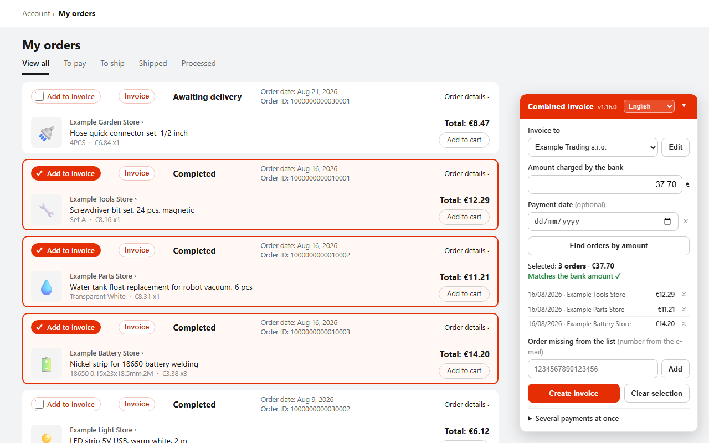
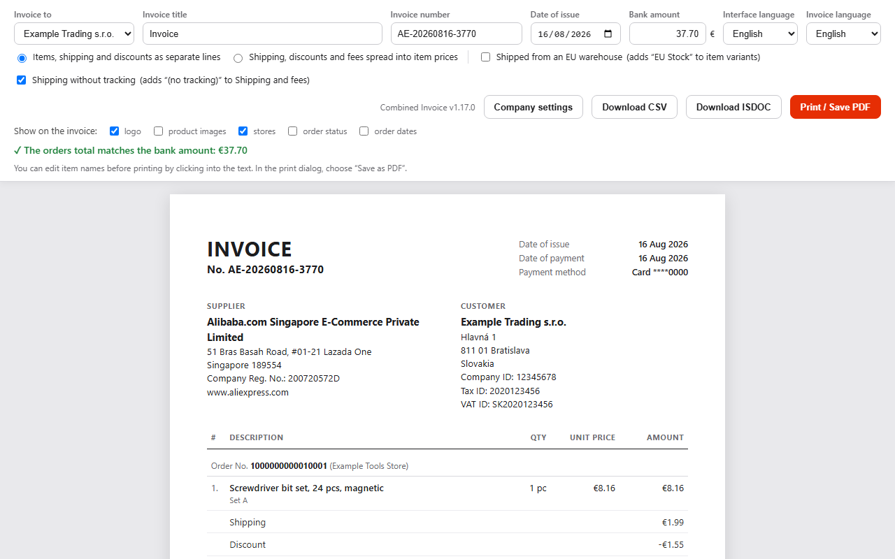

# Combined Invoice for AliExpress

Chrome extension that puts AliExpress orders paid with one bank payment on one invoice, with a total that matches the amount charged to your card to the cent.





## Why

One AliExpress checkout often becomes several orders from different stores, but your bank shows a single card payment. For bookkeeping you want one document per payment. The extension finds the orders behind the payment and builds that document from AliExpress's own order receipts, so the numbers add up.

## Features

- **Tick orders** on the AliExpress "My orders" page or let the extension **find them by the bank amount** (and optionally the payment date, also 1 to 3 days earlier because banks post card payments later). It loads older orders by itself.
- **Several payments at once**: paste the amounts and dates of your bank statement (one payment per line); the extension finds the orders of each payment and opens one invoice per payment.
- **One PDF for many invoices**: all invoices of several payments or of a period on one page, each starting on a new printed page, so one print gives one PDF.
- **Export for accounting**: download the shown invoices as CSV (lines and totals) or as ISDOC electronic invoices (the Czech and Slovak standard that accounting software imports).
- **Credit notes** for refunded orders, from the same order receipts.
- **One click per order**: an Invoice button next to every order and on the order detail page, or invoices for a whole period, one per day or per order.
- **Your choice of details**: company logo, product images, stores, order status and order dates on the invoice, each optional.
- **Changes right on the invoice**: click a quantity, a unit price or a shipping, discount or fee amount and type a new one; the line, the order total and the VAT are calculated again. Add items and fees by hand, rename lines, and undo all changes with one click.
- **Panel where you want it**: on the side next to the invoice, at the top, or hidden with just a print button left.
- **Accurate totals** from the official order receipt (the data behind AliExpress's "Receipt" button): items, shipping, discounts, fees and VAT. Summary lines shown twice, symbolic shipping that is not charged and orders skipped in the order list are handled.
- **Missing orders**: add an order by its number from the confirmation e-mail. With a payment date the extension also fills in orders that AliExpress skipped in the list.
- **Invoice** in any of the 17 languages, set separately from the interface: items, shipping and discounts as separate lines, or spread into item prices. Several customer companies (company ID, tax ID, VAT ID), optional notes for goods from an EU warehouse and for shipping without tracking, print or save as PDF without browser header and footer.
- **Interface in 17 languages**: English, German, French, Spanish, Italian, Portuguese, Dutch, Polish, Czech, Slovak, Hungarian, Romanian, Ukrainian, Russian, Turkish, Japanese, Korean.
- **Private**: runs only in your browser, reads only your own signed-in account, sends nothing anywhere, no affiliate links. See [PRIVACY.md](PRIVACY.md).

## Install

- **Chrome Web Store**: [Combined Invoice for AliExpress](https://chromewebstore.google.com/detail/combined-invoice-for-alie/ajnecbhkoohhidmgjphfdgeahjhmhfab)
- **From source**: download this repository, open `chrome://extensions`, turn on *Developer mode*, click *Load unpacked* and select the folder. Requires Chrome 131 or newer.

## Use

1. Open [My orders](https://www.aliexpress.com/p/order/index.html) on AliExpress. A panel appears in the bottom right corner.
2. Choose the company the invoice is for (first fill it in under *Edit*).
3. Enter the amount from your bank statement and, optionally, the payment date, then click *Find orders by amount*, or tick the orders yourself.
4. Click *Create invoice*, check it (names, quantities, prices and amounts can be changed right on the invoice) and use *Print / Save PDF*, or download it as CSV or ISDOC.

The version shown in the panel header tells you which version is loaded.

## Development

```
npm test                          # unit tests (totals, receipts, translations, settings, export)
npm run check                     # files and commits: no personal data or e-mail addresses
node tools/build-store.js         # Chrome Web Store package -> dist/*.zip
node tools/make-store-images.js   # store screenshots with demo data (needs Chrome)
npm run icons                     # icons
npm run locales                   # _locales (name and description for Chrome)
```

`npm run check` also runs before every `git push` once the hook is enabled with `git config core.hooksPath .githooks`.

- `src/core.js` - amounts, receipts, allocation, search by amount (runs in Node too)
- `src/page-bridge.js` - reads order receipts through the AliExpress page's own request library
- `src/orders.js`, `src/orders.css` - panel and checkboxes on "My orders"
- `src/invoice.*` - the invoice page
- `src/documents.js`, `src/export.js` - the invoices of the invoice page and their CSV and ISDOC export (run in Node too)
- `src/options.*`, `src/settings.js` - settings, backup and restore
- `src/i18n.js` - translations; `test/i18n.test.js` checks that no language misses a text
- `store/` - Chrome Web Store listing texts, privacy answers, screenshots and the publishing guide

The extension depends on AliExpress's internal receipt API (`mtop.global.finance.taxation.invoice.queryOrderReceiptInfo`). If AliExpress changes it, the extension needs an update.

## Disclaimer

Not affiliated with AliExpress or Alibaba. The invoice is compiled by the user from their AliExpress order data; check your local accounting rules for how to use it.

## License

[MIT](LICENSE)
