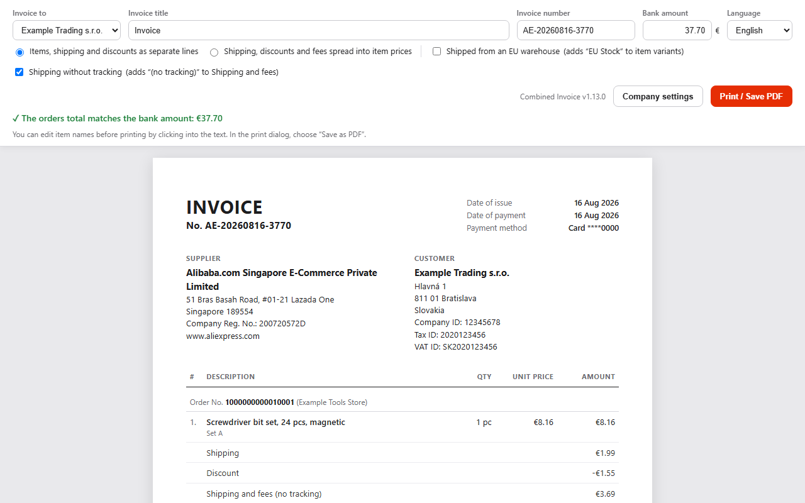

# Combined Invoice for AliExpress

Chrome extension that puts AliExpress orders paid with one bank payment on one invoice, with a total that matches the amount charged to your card to the cent.



## Why

One AliExpress checkout often becomes several orders from different stores, but your bank shows a single card payment. For bookkeeping you want one document per payment. The extension finds the orders behind the payment and builds that document from AliExpress's own order receipts, so the numbers add up.

## Features

- **Tick orders** on the AliExpress "My orders" page or let the extension **find them by the bank amount** (and optionally the payment date, also 1 to 3 days earlier because banks post card payments later). It loads older orders by itself.
- **Accurate totals** from the official order receipt (the data behind AliExpress's "Receipt" button): items, shipping, discounts, fees and VAT. Summary lines shown twice, symbolic shipping that is not charged and orders skipped in the order list are handled.
- **Missing orders**: add an order by its number from the confirmation e-mail. With a payment date the extension also fills in orders that AliExpress skipped in the list.
- **Invoice** in English: items, shipping and discounts as separate lines, or spread into item prices. Several customer companies (company ID, tax ID, VAT ID), optional "EU Stock" and "(no tracking)" notes, print or save as PDF without browser header and footer.
- **Interface in 10 languages**: English, Slovak, Czech, Hungarian, Polish, German, Spanish, French, Portuguese, Russian.
- **Private**: runs only in your browser, reads only your own signed-in account, sends nothing anywhere. See [PRIVACY.md](PRIVACY.md).

## Install

- **Chrome Web Store**: link will be added after publication.
- **From source**: download this repository, open `chrome://extensions`, turn on *Developer mode*, click *Load unpacked* and select the folder. Requires Chrome 131 or newer.

## Use

1. Open [My orders](https://www.aliexpress.com/p/order/index.html) on AliExpress. A panel appears in the bottom right corner.
2. Choose the company the invoice is for (first fill it in under *Edit*).
3. Enter the amount from your bank statement and, optionally, the payment date, then click *Find orders by amount*, or tick the orders yourself.
4. Click *Create invoice*, check it and use *Print / Save PDF*.

The version shown in the panel header tells you which version is loaded.

## Development

```
npm test                          # unit tests (totals, receipts, translations, settings)
node tools/build-store.js         # Chrome Web Store package -> dist/*.zip
node tools/make-store-images.js   # store screenshots with demo data (needs Chrome)
npm run icons                     # icons
npm run locales                   # _locales (name and description for Chrome)
```

- `src/core.js` - amounts, receipts, allocation, search by amount (runs in Node too)
- `src/page-bridge.js` - reads order receipts through the AliExpress page's own request library
- `src/orders.js`, `src/orders.css` - panel and checkboxes on "My orders"
- `src/invoice.*` - the invoice page
- `src/options.*`, `src/settings.js` - settings, backup and restore
- `src/i18n.js` - translations; `test/i18n.test.js` checks that no language misses a text
- `store/` - Chrome Web Store listing texts, privacy answers, screenshots and the publishing guide

The extension depends on AliExpress's internal receipt API (`mtop.global.finance.taxation.invoice.queryOrderReceiptInfo`). If AliExpress changes it, the extension needs an update.

## Disclaimer

Not affiliated with AliExpress or Alibaba. The invoice is compiled by the user from their AliExpress order data; check your local accounting rules for how to use it.

## License

[MIT](LICENSE)
